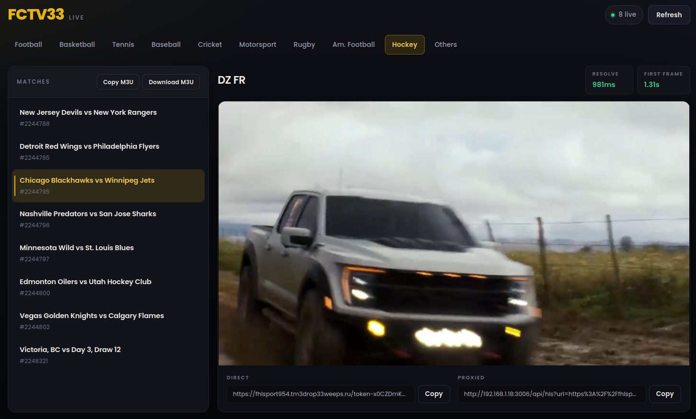

<div align="center">

# 📡 FCTV33 Stream Resolver

**Self-hosted HLS stream resolver & m3u8 proxy for live FCTV33 sports.**

Dynamic IPTV playlist · Docker packaging · Reverse-proxy-aware links · Zero runtime dependencies

[](https://nodejs.org/)
[](https://www.typescriptlang.org/)
[](#-docker)
[](#-features)
[](LICENSE)

[Quick Start](#-quick-start) · [Docker](#-docker) · [Web UI](#-web-ui) · [REST API](#-rest-api) · [IPTV Playlist](#iptv-playlist) · [Common Issues](#-common-issues)




</div>

> [!WARNING]
> This project is for **personal learning and local experimentation** with HLS resolution, signed API clients, and referer-aware m3u8 proxying. Respect the terms of service and copyright of any upstream content provider — **you** are responsible for how you use this software.

---

## 🚀 Quick Start

Requires **Node.js 20+** (native `fetch` and ES modules).

```bash
git clone https://github.com/Lunatic16/fctv33-resolver.git
cd fctv33-resolver
npm start
```

`npm start` compiles TypeScript, frees the listen port if an old process is still bound, and runs `dist/server/main.js`. The terminal prints the base URL:

```text
http://localhost:3000
```

Open that address in a browser: pick a sport tab, click a live match, and the player resolves the stream and autoplays — with on-screen chips for resolve latency and time to first frame.

**From the shell:**

```bash
# Football live list
curl -s "http://localhost:3000/api/live?sportType=1" | jq .

# Resolve one match (replace matchId with a value from the list)
curl -s "http://localhost:3000/api/resolve?matchId=4331876&sportType=1" | jq .

# IPTV playlist of every live match across all sports
curl -s "http://localhost:3000/playlist.m3u"
```

> [!TIP]
> Override the port with `PORT=8080 npm start`.

## 🐳 Docker

Multi-stage build on `node:22-alpine`: stage one compiles TypeScript, stage two ships only `dist/` (the app has zero runtime npm packages). Runs as the non-root `node` user.

```bash
# Build and run
docker build -t fctv33-stream-resolver .
docker run -d --name fctv33 -p 3000:3000 fctv33-stream-resolver

# Or with compose (builds the image, maps port 3000, restarts on failure)
docker compose up -d --build
```

`docker-compose.yml`:

```yaml
services:
  fctv33:
    build: .
    image: fctv33-stream-resolver:latest
    container_name: fctv33
    ports:
      - "3000:3000"
    environment:
      PORT: 3000
    restart: unless-stopped
```

To listen on a different host port, change the left side of the mapping (`"8080:3000"`); `PORT` inside the container stays `3000`.

## 💡 Why This Exists

Live FCTV33 playback is not a single public `.m3u8` link. The site bootstraps a data API host, signs protobuf calls, returns an obfuscated stream URL, and expects the iframe player origin as **Referer** / **Origin** on CDN playlist and segment requests — headers browsers cannot set on cross-origin media fetches, so a bare CDN URL often fails inside `<video>` or hls.js. Many live playlists also use **CDN Smart Link (CSL)** placeholders: segment URLs that return **487** unless the player (or this proxy) rewrites them to signed CTU hosts from `_ctump` / `_ctuph`.

This project turns that whole chain into four local endpoints:

1. **Live list** — matches that currently have streams, filtered by sport.
2. **Resolve** — match id → tokenized `streamUrl`, player `referer`, CSL salt/geo context, and a proxied `playableUrl`.
3. **HLS proxy** — fetches upstream with the correct headers, resolves CSL segments to CTU when needed, and rewrites every playlist URI so media keeps flowing through the same proxy. A `slot` mode lets IPTV players tune in with a stable URL that unlocks fresh at tune-in time.
4. **IPTV playlist** — one dynamic `.m3u` of every live match, ready for VLC, mpv, or TiviMate.

The result: a self-hosted resolver you can drive from the UI, from scripts, or from a couch-side IPTV app — without pasting match page URLs or manually injecting headers.

## ✨ Features

| | |
| --- | --- |
| 🎬 **Playback** | Live match rail with sport filters (Football, Basketball, Tennis, Cricket, and more) · one-click resolve into a playable HLS session with on-screen timing · built-in **hls.js** player with autoplay after manifest parse · copyable **Direct** CDN URL and **Proxied** URL, with a clipboard that works over plain-HTTP LAN access (Clipboard API + `execCommand` fallback) · equal-height match list and player stage on desktop |
| 📺 **IPTV** | Dynamic `.m3u` playlist with one-click **Copy M3U** / **Download M3U** in the rail header · stable slot URLs that unlock fresh at tune-in · self-heals when upstream tokens rotate |
| 🔀 **Deployment** | Reverse-proxy-aware link generation — honors `X-Forwarded-Host` / `X-Forwarded-Proto`, so resolved URLs and rewritten playlist URIs stay correct behind nginx, Traefik, or Caddy · open **CORS** on all API and playlist endpoints with `OPTIONS` preflight handling · small **Docker** image (`node:22-alpine`, dist-only, non-root) |
| 🔐 **Under the hood** | Signed upstream access: MD5 request-hash prefix, body signature keys, protobuf envelopes · stream URL construction with ROT47 decode and AES-256-CBC session token wrapping · minimal m3u8 proxy: header injection, playlist rewrite, MPEG-TS passthrough · CDN Smart Link support: ROT13/base64 decode, geo-ordered CTU hosts, `_s2` MD5 signing |
| 🧱 **Engineering** | Pure TypeScript sources (`src/` → `dist/`) · **zero runtime npm packages** — playback uses remote [hls.js](https://github.com/video-dev/hls.js) |

## 🔍 How Resolution Works

The server talks to the upstream data API with **signed protobuf requests**, decodes **ROT47** stream payloads, builds an **AES-256-CBC** session token URL, then relays HLS manifests and MPEG-TS segments with the player **Referer** headers the CDN expects. When playlists use CSL placeholder segment URLs, the proxy decodes them (ROT13 + base64), signs CTU hosts, and fetches real MPEG-TS instead of the raw CDN placeholders.

<details>
<summary><strong>The full 10-step chain</strong> (same order as <code>src/handlers/resolve.ts</code> and <code>src/api/client.ts</code>)</summary>

1. **Entry bootstrap** — `GET https://www.fctv33.com/` HTML is scanned for the site digit (for example `foth`) and the `apis-data*` host. Results are cached in process memory.
2. **Player referer** — site params (`/api/common/params`, ROT47 JSON) expose iframe player domains; the first domain becomes the CDN referer. A digit-keyed fallback list is used if needed.
3. **Geo** — `/api/user/info` protobuf yields optional country and continent for stream detail.
4. **Signatures** — `/api/common/bs` returns body-signing material for codes `0x64`–`0x69`. Live list uses `0x64`; match detail uses `0x66`. Signature keys are cached per `matchId:sportType` pair.
5. **Live or detail** — signed `GET` under `/sfver{md5-prefix}{suffix}/api/match/…` with ordered query params (`matchId`, `sportType`, `language`, `stream`).
6. **Stream detail** — `/api/stream/detail` returns an obfuscated URL plus the `rb-session` response header.
7. **Token URL** — ROT47 decode, strip the leading marker, AES-encrypt the session, and assemble `https://…/token-…/….m3u8`.
8. **CSL config** — site params `common:cdnSmartLink` supply salt, retry, and timeout values used when proxying Smart Link segments.
9. **Playable link** — `{public-origin}/api/hls?url=…&referer=…` plus geo and CSL query params so the browser never talks to the CDN directly; the proxy handles CTU segment fetches.
10. **Slot relay** — `/api/hls?slot={sportType}:{matchId}` stores the resolved stream in memory; playlist refreshes reuse it, and a failed manifest fetch forces one re-unlock, so an expired upstream token never strands a viewer.

</details>

## 🧱 Architecture

```text
┌─────────────────┐     ┌──────────────────┐     ┌─────────────────────┐
│  Web UI / curl  │────▶│  Local HTTP      │────▶│  FCTV33 entry +     │
│  hls.js player  │◀────│  :3000           │◀────│  apis-data API      │
│  IPTV players   │     │                  │     └─────────────────────┘
└─────────────────┘     │  /api/live       │                │
                        │  /api/resolve    │                ▼
                        │  /api/hls  ──────┼──────▶  CDN m3u8 + CTU .ts
                        │  /playlist.m3u   │         (referer + CSL when needed)
                        └──────────────────┘
```

| Layer | Responsibility |
| --- | --- |
| `server/` | Node `http` server, router, static client assets, public-origin + CORS helpers |
| `handlers/` | JSON handlers for live list and match resolve, shared resolve pipeline, IPTV playlist |
| `api/` | Bootstrap, signed client, protobuf field parsers, CSL config |
| `crypto/` | Param sort + MD5 prefix, ROT47, ROT13, AES stream token |
| `proxy/` | Upstream fetch, slot cache, CSL→CTU segment resolve, playlist rewrite |
| `client/` | Live sports UI, player, export fields, playlist actions |
| `config/` | Entry origin, path constants, signature codes, sport labels, user-agent |

Request flow at the router:

| Path | Handler |
| --- | --- |
| `GET /api/live` | `handlers/live.ts` |
| `GET /api/resolve` | `handlers/match.ts` → `handlers/resolve.ts` |
| `GET /api/hls` | `proxy/hls.ts` (explicit `url` mode or `slot` mode) |
| `GET /playlist.m3u` | `handlers/playlist.ts` |
| everything else | `server/static.ts` (UI under `dist/client/`) |

## 📺 Web UI

The homepage is a compact live console — not a page-URL paste form.

### Layout

- **Top bar** — FCTV33 branding, live count chip, Refresh
- **Sport tabs** — horizontal filter (**All Sports** default — every live match in one request, labeled by sport — plus Football, Basketball, Tennis, and the site's full sport nav: Others, Motorsport, Rugby, Am. Football, Aussie Rules, Cricket, Hockey, Badminton, Baseball, Volleyball, Fighting, Cycling, Handball)
- **Match rail** — scrollable list of live fixtures with match ids, plus **Copy M3U** and **Download M3U** actions in the rail header
- **Stage** — title, resolve / first-frame timings, 16:9 player, export fields

On wide screens the rail height matches the player + exports block so the video stays visible while you scroll matches. On smaller screens the player stacks first and the list uses a capped height with its own scroll.

<details>
<summary><strong>Interaction flow & clipboard fallback</strong></summary>

**Flow**

1. The UI calls `/api/live?sportType=…` and fills the rail.
2. A click calls `/api/resolve?matchId=…&sportType=…`.
3. Timing starts immediately; resolve time freezes when JSON returns; first-frame time freezes when `<video>` fires `playing`.
4. The player attaches hls.js to `playableUrl` (or native HLS on Safari when supported).
5. Export inputs fill with Direct and Proxied URLs; each has a Copy button.
6. **Copy M3U** fetches `/playlist.m3u` and copies the full playlist text; **Download M3U** saves `fctv33-live.m3u` via `Content-Disposition: attachment`.

**Clipboard everywhere**

Copy buttons use the async Clipboard API when available and fall back to a hidden-textarea `document.execCommand("copy")` otherwise, with a 1.5 s timeout race against stalled clipboard promises. That keeps the buttons working over **plain-HTTP LAN access** (`http://192.168.x.x:3000`) from desktops, phones, and TV webviews, where `navigator.clipboard` is unavailable or unreliable. A failing copy flashes **Copy failed** instead of throwing.

If the live list or resolve fails, an error banner appears above the workspace and the status chip switches to a failed state.

</details>

## 🔌 REST API

Base URL defaults to `http://localhost:3000`. All resolve and live responses are JSON. The HLS proxy returns playlist text or binary segments. Every `/api/*` and `/playlist*` response carries `Access-Control-Allow-Origin: *` plus `OPTIONS` preflight support (see [Reverse Proxy and CORS](#-reverse-proxy-and-cors)).

### Overview

| Method | Path | Query | Success body |
| --- | --- | --- | --- |
| `GET` | `/api/live` | `sportType` | `{ sportType, matches }` |
| `GET` | `/api/resolve` | `matchId`, `sportType` | stream object (below) |
| `GET` | `/api/hls` | `url` + `referer`, **or** `slot`, optional CSL/geo | m3u8 text or MPEG-TS bytes |
| `GET` | `/playlist.m3u` | `sportType`, `download` | IPTV `.m3u` text |

Unknown `/api/*` paths return `{ "error": "not found" }` with status `404`. Upstream failures on live/resolve use status `502` with an `error` string. Validation errors use `400`.

### List Live Matches

Returns fixtures that currently advertise streams for the given sport.

```bash
curl -s "http://localhost:3000/api/live?sportType=1"
```

```json
{
  "sportType": 1,
  "matches": [
    {
      "matchId": 4331876,
      "sportType": 1,
      "name": "Team A vs Team B"
    }
  ]
}
```

| Query | Required | Notes |
| --- | --- | --- |
| `sportType` | no | Defaults to `1` (Football). Must be a finite number. `0` returns every live match across all sports — each match carries its own `sportType`. |

Empty `matches` means nothing live for that sport right now — not necessarily an API failure.

### Resolve a Match

Runs the full upstream chain and returns both the raw CDN playlist and a proxied URL. `playableUrl` is built against the request's public origin (see [Reverse Proxy and CORS](#-reverse-proxy-and-cors)).

```bash
curl -s "http://localhost:3000/api/resolve?matchId=4331876&sportType=1"
```

```json
{
  "name": "Stream label",
  "matchId": "4331876",
  "sportType": 1,
  "streamUrl": "https://cdn.example/token-…/index.m3u8",
  "referer": "https://player.example/",
  "playableUrl": "http://localhost:3000/api/hls?url=…&referer=…&country=…&continent=…&salt=…&maxRetryTimes=…&minFetchTimeout=…"
}
```

| Field | Description |
| --- | --- |
| `name` | Label from the selected stream item |
| `matchId` | Echo of the request (numeric string) |
| `sportType` | Echo of the request |
| `streamUrl` | Tokenized CDN **m3u8** (Direct). Playlist may list CSL placeholder segments that are not playable as raw CDN `.ts` |
| `referer` | Iframe player origin used as `Referer` / `Origin` |
| `playableUrl` | Proxied URL (Proxied) with referer, geo, and CSL params for browser playback |

| Query | Required | Notes |
| --- | --- | --- |
| `matchId` | yes | Digits only |
| `sportType` | yes | Finite number matching the live list entry |

### Proxy HLS

Fetches an upstream playlist or segment with the player referer, then either rewrites the manifest or returns segment bytes. Two modes:

**Explicit mode** (what `resolve` returns): the target URL and proxy context travel in the query string.

```bash
curl -s "http://localhost:3000/api/hls?url=<encoded-m3u8-or-ts>&referer=<player-origin>/"
```

| Query | Required | Notes |
| --- | --- | --- |
| `url` | yes (explicit mode) | Absolute upstream playlist or segment URL |
| `referer` | yes (explicit mode) | Same player origin returned by resolve (include trailing `/` as returned) |
| `slot` | yes (slot mode) | Stable `sportType:matchId` relay key, e.g. `1%3A4331876` |
| `country` | no | Geo hint for CTU host order (from resolve) |
| `continent` | no | Geo hint for CTU host order (from resolve) |
| `salt` | no | CSL `_s2` signing salt from `common:cdnSmartLink` |
| `maxRetryTimes` | no | CSL CTU retry budget |
| `minFetchTimeout` | no | CSL per-host timeout floor (seconds) |

**Slot mode** (what the IPTV playlist uses): pass only `slot=sportType:matchId`. The server resolves the match lazily at tune-in time, caches the signed upstream URL for 10 minutes, and injects referer/geo/CSL itself — no secrets in the URL, nothing expires in your player's channel list. If a manifest fetch fails (rotated or expired upstream token), the slot is re-unlocked once and the fetch retried; segment failures return `502` so the player's next playlist refresh self-heals through the slot.

Behavior:

- Detects playlists via `#EXTM3U` in the body or `.m3u8` in the URL.
- Rewrites non-comment URI lines to absolute URLs that point back at `/api/hls` with the same proxy context — on the request's public origin, so the rewrite is correct behind a reverse proxy.
- When a segment URL carries CSL params (`_ctump`, …), decodes the CTU list, signs hosts with `_s2`, and fetches MPEG-TS from CTU (raw CDN placeholders typically return **487**).
- Serves playlists as `application/vnd.apple.mpegurl` and segments as `video/mp2t`.
- Sets `Cache-Control: no-store`.
- On upstream failure returns plain-text status `502`.

### IPTV Playlist

One dynamic `.m3u` listing **every live match across all sports** (or a single sport with `sportType`). Entries are stable slot URLs — adding the playlist to an IPTV app is set-and-forget, because each channel unlocks fresh at tune-in time and self-heals when tokens rotate.

```bash
# All sports
curl -s "http://localhost:3000/playlist.m3u"

# Football only
curl -s "http://localhost:3000/playlist.m3u?sportType=1"

# Download as a file (Content-Disposition: attachment)
curl -sOJ "http://localhost:3000/playlist.m3u?download=1"

# Play directly
mpv "http://localhost:3000/playlist.m3u"          # browse channels
vlc "http://localhost:3000/api/hls?slot=1%3A4331876"
```

```m3u
#EXTM3U
#EXTINF:-1 tvg-id="fctv33-1-4331876" tvg-name="Team A vs Team B" group-title="Football",Team A vs Team B
http://localhost:3000/api/hls?slot=1%3A4331876
```

| Query | Required | Notes |
| --- | --- | --- |
| `sportType` | no | Filter to one sport (see [Sport Types](#-sport-types)); invalid values are `400` |
| `download` | no | Any value forces a `fctv33-live.m3u` download instead of inline text |

Notes:

- **Fresh unlock per channel** — entry URLs never contain CDN tokens; the slot resolves at tune-in.
- **Self-healing** — expired upstream tokens trigger one re-unlock on the next manifest fetch.
- **Short server-side TTL** — the all-sports list is fetched with a single upstream request (`sportType 0`, the site's "Live" tab) and cached for 15 s, so IPTV clients polling the playlist do not hammer the catalog (cold fetch ≈ 1 s, warm ≈ instant); if that request fails, the resolver falls back to sweeping each sport individually.
- **Partial failures tolerated** — in the fallback sweep a sport whose upstream list fails is skipped; the playlist only errors (`502`) when every sport fails.
- Served as `audio/x-mpegurl; charset=utf-8` with `Cache-Control: no-store`.
- Entry URLs use the request's public origin, so the same playlist works directly and behind a reverse proxy.

## 🔀 Reverse Proxy and CORS

Generated links (the resolved `playableUrl`, rewritten playlist URIs, and playlist entry URLs) honor standard forwarding headers:

| Header | Effect |
| --- | --- |
| `X-Forwarded-Host` | Public host used in generated links (first value of a comma list) |
| `X-Forwarded-Proto` | Public scheme, `https` behind TLS-terminating proxies |
| `Host` | Fallback when no forwarded headers are present |

Example nginx site:

```nginx
server {
    listen 443 ssl;
    server_name tv.example.com;

    location / {
        proxy_pass http://127.0.0.1:3000;
        proxy_set_header Host $host;
        proxy_set_header X-Forwarded-Host $host;
        proxy_set_header X-Forwarded-Proto $scheme;
    }
}
```

With this in place, `playableUrl` returns `https://tv.example.com/api/hls?…`, manifest rewrites loop back through `https://tv.example.com`, and playlist entries point at the public host — so the same deployment serves `localhost`, LAN, and proxied clients without rebuilding.

CORS: all `/api/*` and `/playlist*` responses send `Access-Control-Allow-Origin: *`, `Access-Control-Allow-Methods: GET, OPTIONS`, and `Access-Control-Allow-Headers: Content-Type, Range`; `OPTIONS` requests get a `204` preflight response. Point other web apps or web-based IPTV frontends at the API freely.

## 🎬 Playback

### Browser Player

The UI loads `playableUrl` with hls.js when Media Source Extensions are available. On Apple platforms that support native HLS, the video element can take the proxied URL directly. Autoplay starts after the manifest is parsed.

### IPTV Players

Add `http://<host>:3000/playlist.m3u` as an M3U playlist in VLC, mpv, TiviMate, or any IPTV app. Channels are grouped by sport via `group-title`. Re-tuning a channel always pays a fresh unlock, so stale tokens never break a channel permanently.

### Proxied Playlist

Use `playableUrl` whenever the client cannot attach custom HTTP headers (most browser players, many embed setups, simple HLS demos). All playlist and segment traffic stays on the resolver host and inherits the referer from the proxy.

### Direct CDN with Referer

`streamUrl` is the tokenized CDN playlist. Opening it alone in a normal browser tab usually fails. Even with `referer`, CSL streams often cannot play Direct: playlist fetch may succeed while segment URLs stay as CDN placeholders (**487**). Prefer `playableUrl` for reliable playback.

## 🏟 Sport Types

Values match the upstream `sportType` field and the UI tabs (in the site's own nav order).

| `sportType` | Label |
| ---: | --- |
| 0 | All Sports (the site's "Live" tab — one request, every sport) |
| 1 | Football |
| 2 | Basketball |
| 3 | Tennis |
| 90 | Others |
| 7 | Motorsport |
| 8 | Rugby |
| 9 | Am. Football |
| 10 | Aussie Rules |
| 6 | Cricket |
| 11 | Hockey |
| 12 | Badminton |
| 4 | Baseball |
| 13 | Volleyball |
| 14 | Fighting |
| 15 | Cycling |
| 16 | Handball |

## 🧰 Stack and Scripts

| Piece | Detail |
| --- | --- |
| Runtime | Node.js ≥ 20 |
| Language | TypeScript (strict), ESM (`"type": "module"`) |
| Server build | `tsc -p tsconfig.json` → `dist/` |
| Client build | `tsc -p tsconfig.client.json` → `dist/client/` plus copied HTML/CSS |
| Runtime deps | None |
| Dev deps | `typescript`, `@types/node` |
| Player | hls.js from jsDelivr in `index.html` |
| Container | `node:22-alpine`, multi-stage, non-root, dist-only |

```bash
npm start        # build, kill stale listeners on PORT, run the server
npm run build    # compile server + client assets only
npm run typecheck
```

Source maps are disabled. The listen URL is the only startup log line.

## 🔧 Configuration

| Variable | Default | Effect |
| --- | --- | --- |
| `PORT` | `3000` | HTTP listen port for the UI and API |

Entry origin, API paths, signature codes, sport labels, and user-agent live in `src/config/site.ts`. Stream AES key material lives in `src/crypto/stream-token.ts` (derived from the public client bundle constants).

## 📁 Source Layout

<details>
<summary><strong>Project tree</strong></summary>

```text
src/
  api/
    bootstrap.ts    # entry HTML → digit + apis-data base URL
    client.ts       # signed live/detail/stream client + CSL config
    protobuf.ts     # envelope, live list, match/stream detail parsers
  crypto/
    request-hash.ts # param order + MD5 prefix for /sfver…
    rot13.ts        # ROT13 helper for CSL params
    rot47.ts        # ROT47 helper
    stream-token.ts # AES tokenized CDN URL
  handlers/
    live.ts         # GET /api/live
    match.ts        # GET /api/resolve
    playlist.ts     # GET /playlist.m3u — dynamic IPTV playlist
    resolve.ts      # shared match → stream unlock pipeline
  proxy/
    csl.ts          # CDN Smart Link decode, CTU sign, segment fetch
    hls.ts          # GET /api/hls (explicit + slot modes)
    slots.ts        # slot cache: lazy tune-in resolve + re-unlock
  server/
    http.ts         # public-origin (X-Forwarded-*) + CORS helpers
    main.ts         # http.createServer
    router.ts       # path dispatch
    static.ts       # dist/client assets
  client/
    app.ts          # live UI, hls.js wiring, clipboard fallback, M3U actions
    index.html
    styles.css
  config/
    site.ts         # origins, paths, signatures, sport labels, UA
Dockerfile          # multi-stage node:22-alpine build
docker-compose.yml  # one-service deployment
```

</details>

## 🧯 Common Issues

| Symptom | Likely cause |
| --- | --- |
| Live list empty | No streams for that sport at the moment; try another tab or Refresh |
| Resolve `502` | Upstream signature, geo, or stream detail failure — check the JSON `error` string; occasional one-off failures are upstream flakiness, retry |
| Browser plays black / errors | Prefer `playableUrl`; Direct CDN often needs referer the browser cannot set |
| Segments fail with **487** | CSL placeholders on the CDN; use `playableUrl` or the playlist so the proxy fetches signed CTU |
| Playlist empty | Nothing live across all sports right now — not an error |
| Playlist `502` | Upstream catalog unreachable for every sport (network or entry-page shape change); per-sport failures are skipped individually |
| IPTV channel fails once | Transient upstream flake or rotated token; the next tune-in or playlist refresh re-unlocks the slot |
| Copy button says **Copy failed** | Browser denied clipboard access; some plain-HTTP browsers also block `execCommand` — use **Download M3U** instead |
| Generated URLs show the wrong host | Set `X-Forwarded-Host` / `X-Forwarded-Proto` at the proxy (see [Reverse Proxy and CORS](#-reverse-proxy-and-cors)) |
| Port already in use | `npm start` tries to free `PORT`; otherwise set `PORT=8080` |
| Bootstrap errors | Entry page HTML shape changed; bootstrap regex in `api/bootstrap.ts` may need an update |

## 📜 Disclaimer

This project is for personal learning and local experimentation with HLS resolution, signed API clients, and referer-aware m3u8 proxying. Respect the terms of service and copyright of any upstream content provider. You are responsible for how you use the software.

## 📄 License

Released under the [MIT License](LICENSE) © [sharoon7171](https://github.com/sharoon7171)

## 🤝 Contributing

Issues and pull requests are welcome. For larger changes (new sports, proxy behavior, packaging), open an issue first so we can align on the approach.
